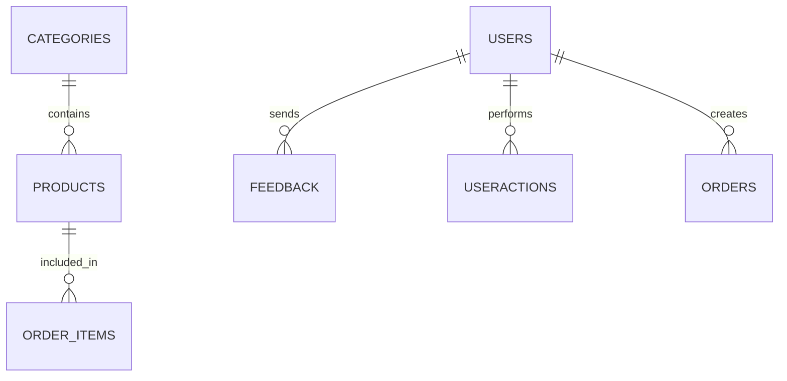

# Лабораторная работа
## MOTORA — сайт автомобильного салона 

## 1. Технологический стек

- **Node.js + Express** — HTTP-сервер и REST API.
- **MongoDB + Mongoose** — хранение пользователей, автомобилей и пользовательских данных.
- **express-session + connect-mongo** — сессии пользователей в отдельной коллекции MongoDB `sessions`.
- **bcryptjs** — хэширование паролей (12 раундов соли).
- **express-validator** — серверная валидация форм.
- **HTML5, CSS3, Vanilla JS, fetch** — клиентская часть без сборщика.

## 2. Структура базы данных

В MongoDB вместо SQL-таблиц используются коллекции. В проекте есть шесть прикладных коллекций и служебная коллекция сессий:

| Коллекция | Назначение | Связи |
|---|---|---|
| `users` | Пользователи, email, роль, хэш пароля | Родитель для `feedback`, `useractions`, `orders` |
| `categories` | Категории автомобилей | Один ко многим с `products` |
| `products` | Автомобили каталога | Ссылка `category` на `categories` |
| `feedback` | Обращения и отзывы клиентов | Ссылка `user` → `users` (для гостя `null`) |
| `useractions` | Долгосрочный журнал действий | Ссылка `user` → `users` |
| `orders` | Оформленные заказы пользователя, состав, снимки цен, контакт для связи и статус | Ссылка `user` → `users`, позиции содержат ссылку на `products` и снимок названия/цены |
| `sessions` | Сессии `express-session` | Создаётся и обслуживается `connect-mongo` |
| `requests` | Запросы по конкретному авто | Создаётся и обслуживается `connect-mongo` |
| `subscribers` | Пользователи на рассылку по почте | Создаётся и обслуживается `connect-mongo` |

Схема связей прикладных коллекций (ссылки `ObjectId`):



**Связи и каскадное удаление.** MongoDB не поддерживает SQL-ограничения `FOREIGN KEY` и `ON DELETE CASCADE`. Вместо них Mongoose-документы хранят ссылки `ObjectId` (`ref`), а каскад выполняется серверной логикой:

- при удалении пользователя удаляются его обращения, журнал действий и заказы;
- при удалении автомобиля в `orders` сохраняются снимки позиций, а ссылка на удалённый товар обнуляется;
- отдельного избранного в проекте больше нет: автомобиль добавляется только в корзину, которая хранится в сессии.

## 3. Что реализовано

### Подключение к базе и сессии

- Подключение через `mongoose.connect()`.
- Конфигурация находится в `.env`.
- Сессии сохраняются в коллекции `sessions`, cookie имеет флаги `httpOnly` и `sameSite=lax`.
- Для обычного входа срок cookie — 1 день, при отметке «Запомнить меня» — 30 дней.
- Краткосрочные данные сессии: последние просмотренные автомобили (`recentViewed`), пять последних поисковых запросов (`searchHistory`) и корзина (`cart`). Корзина доступна гостю и авторизованному пользователю; после входа сохраняется в новой сессии.

### Формы и валидация

1. Регистрация: имя, email, телефон, пароль, повтор пароля и согласия. Проверка выполняется на клиенте и сервере; пароль хэшируется через bcrypt.
2. Авторизация: email, пароль, опция «Запомнить меня», ограничение частоты неудачных попыток.
3. Обратная связь: имя, email, тема, текст сообщения и согласие. Обращение сохраняется в `feedback`.
4. Поиск: поиск по названию/типу двигателя, фильтрация по категории и сортировка цены. Есть клиентская и серверная проверка длины запроса.

### Личный кабинет (`profile.html`)

Доступ к API личного кабинета разрешён только при активной сессии. Пользователь может:

- просматривать и редактировать имя и email;
- сменить пароль после проверки старого пароля;
- просматривать заказы, последние просмотры и последние пять поисковых запросов;
- переходить в корзину и оформлять заказ;
- просматривать свои обращения из `feedback`;
- просматривать журнал действий из `useractions`.

Корзина хранится в пользовательской сессии MongoDB. При оформлении авторизованным пользователем создаётся запись в `orders` со снимком названия и цены каждой позиции, количеством, итоговой суммой и контактными данными. Оплата на сайте не проводится: заказ является заявкой для последующего подтверждения менеджером.

### Журнал действий

В `useractions` записываются вход/выход, регистрация, изменение профиля и пароля, отправка обращений, оформление заказов (`order_created`), а также административные изменения каталога и модерации.

### Админ-панель (`admin.html`)

Доступна только пользователю с ролью `admin`. Реализованы:

- добавление, редактирование и удаление автомобилей; для изображения указывается локальный путь из `/img/cars/`, а сервер проверяет наличие файла; путь к изображению должен указывать на существующий локальный файл из `/img/cars/`; для изображения указывается локальный путь из `/img/cars/`, а сервер проверяет наличие файла;
- сортировка каталога в админ-панели по названию, цене и дате добавления;
- просмотр, блокировка/разблокировка и удаление пользователей;
- модерация обращений (`pending`, `approved`, `rejected`);
- сводные счётчики и вывод данных на экран.

## 4. Запуск проекта

Требуются Node.js 18+ и доступный экземпляр MongoDB (локально или MongoDB Atlas).

1. Откройте терминал в папке проекта.
2. Установите зависимости:

   ```bash
   npm install
   ```

3. Создайте файл `.env` на основе `.env.example` и укажите строку подключения MongoDB и секрет сессии:

   ```bash
   cp .env.example .env
   ```

   Для Windows можно просто скопировать `.env.example` и переименовать копию в `.env`.

4. Заполните `MONGODB_URI`, `SESSION_SECRET`, `ADMIN_EMAIL` и `ADMIN_PASSWORD` в `.env`. Для учебного запуска подходят локальные значения из шаблона; перед публикацией обязательно замените пароль администратора и секрет.
5. При **первом запуске на пустой базе** создайте категории, 15 автомобилей и администратора:

   ```bash
   npm run seed
   ```

   `seed` сразу записывает локальные пути изображений. Не запускайте эту команду повторно на уже заполненной базе без необходимости: она обновляет тестовые записи автомобилей и данные администратора из `.env`.

6. Если вы переходите со старой версии проекта и база уже содержит автомобили, выполните миграцию:

   ```bash
   npm run migrate:local-images
   ```

   Она обновляет **только поле `image`** у найденных автомобилей. Пользователи, пароли, корзины, обращения, действия и заказы не изменяются. Для новой пустой базы эта миграция не требуется.

7. Если вы переходите с версии, в которой существовало избранное, удалите старую коллекцию и устаревшие поля сессий:

   ```bash
   npm run migrate:remove-favorites
   ```

   Команда безвозвратно удаляет коллекцию `favorites` и старое поле избранного из сериализованных документов `sessions` (а также из нестандартных сессий, где оно записано отдельным полем). Корзина (`cart`), учётные записи, обращения, журнал действий и заказы сохраняются. Команда безопасна для повторного запуска. Перед запуском остановите сервер MOTORA. При необходимости сначала экспортируйте старую коллекцию `favorites` из Compass: миграция предназначена именно для её окончательного удаления.

8. Запустите сервер:

   ```bash
   npm run dev
   ```

   или для обычного запуска:

   ```bash
   npm start
   ```

9. Откройте `http://localhost:3000`.

**Администратор:** данные для входа берутся из `ADMIN_EMAIL` и `ADMIN_PASSWORD` в `.env`. После успешного входа в навигации появится ссылка «Админ-панель».

> Не открывайте HTML-файлы двойным щелчком и не используйте `python -m http.server`: формы и данные требуют Express API, доступного через `http://localhost:3000`.

## 5. Основные API-маршруты

| Метод | Маршрут | Назначение | Доступ |
|---|---|---|---|
| `POST` | `/api/auth/register` | Регистрация | Гость |
| `POST` | `/api/auth/login` | Авторизация | Гость |
| `POST` | `/api/auth/logout` | Выход | Авторизованный |
| `GET` | `/api/auth/me` | Текущий пользователь | Открытый |
| `GET` | `/api/products` | Каталог, поиск, фильтры, сортировка | Открытый |
| `GET` | `/api/products/categories` | Категории | Открытый |
| `POST` | `/api/products/session/view/:id` | Запись просмотра в сессию | Открытый |
| `GET` | `/api/cart` | Получить содержимое корзины и итог | Открытый; корзина хранится в сессии |
| `POST` | `/api/cart/:productId` | Добавить автомобиль в корзину (кнопка с иконкой корзины) | Открытый; корзина хранится в сессии |
| `PATCH/DELETE` | `/api/cart/:productId` | Изменить количество или удалить позицию | Открытый; корзина хранится в сессии |
| `POST` | `/api/cart/checkout` | Оформить заказ и записать его в `orders` | Только авторизованный пользователь |
| `DELETE` | `/api/cart` | Очистить корзину | Открытый; корзина хранится в сессии |
| `POST` | `/api/feedback` | Отправка обращения | Открытый |
| `GET` | `/api/account` | Данные кабинета | Авторизованный |
| `PATCH` | `/api/account/profile` | Изменение профиля | Авторизованный |
| `PATCH` | `/api/account/password` | Смена пароля | Авторизованный |
| `GET` | `/api/admin/stats` | Сводная статистика | Администратор |
| `GET/POST` | `/api/admin/products` | Список и добавление автомобилей | Администратор |
| `PUT/DELETE` | `/api/admin/products/:id` | Изменение и удаление автомобиля | Администратор |
| `GET` | `/api/admin/users` | Список пользователей | Администратор |
| `PATCH/DELETE` | `/api/admin/users/:id/status` и `/api/admin/users/:id` | Блокировка/удаление пользователя | Администратор |
| `GET` | `/api/admin/feedback` | Список обращений | Администратор |
| `PATCH` | `/api/admin/feedback/:id/status` | Изменение статуса обращения | Администратор |

## 6. Контрольные данные для демонстрации

- Зарегистрируйте обычного пользователя через `Контакты → Регистрация`.
- Добавьте один или несколько автомобилей в корзину кнопкой с иконкой корзины, откройте `cart.html`, измените количество и удалите ненужные позиции.
- Войдите в аккаунт, укажите контактный телефон и оформите заказ. Проверьте коллекцию `orders` в MongoDB Compass.
- Откройте личный кабинет: в истории заказов появится оформленная заявка, а в истории поиска отображаются не более пяти последних запросов.
- Отправьте обращение через форму обратной связи: оно появится в кабинете и админ-панели.
- Для админ-панели войдите с учётными данными `ADMIN_EMAIL` / `ADMIN_PASSWORD` из `.env`.
- В админ-панели создайте/измените/удалите модель и поменяйте статус обращения.

## 7. Важные файлы

```text
config/db.js             подключение MongoDB
models/                  Mongoose-схемы коллекций
middleware/auth.js       проверка активной сессии и роли администратора
routes/                  REST API: auth, products, cart, feedback, account, admin
utils/logAction.js       запись действий в useractions
scripts/seed.js          начальное заполнение категорий, автомобилей и администратора
public/                  клиентские HTML, CSS, JavaScript и документы (HTML/TXT)
server.js                запуск Express и настройка Mongo-сессий
.env.example             шаблон переменных окружения
```


## Дополнения интерфейса

- Добавлена страница корзины `cart.html`; корзина поддерживает изменение количества, удаление позиций и оформление заказа после авторизации. Отдельная функциональность избранного и её коллекция удалены.
- Личный кабинет `profile.html` перестроен в разделы с боковой навигацией, карточками статистики и подробной историей заказов.
- В истории поиска сохраняются и показываются только пять последних уникальных запросов.
- При первом посещении появляется cookie-уведомление со ссылкой на `cookie-policy.html`; выбор хранится в `motora_cookie_consent`. В проекте используются только необходимые cookies.
- Для политики персональных данных, согласия и политики cookies доступны HTML-страницы и отдельные TXT-файлы для скачивания.

- Главная страница содержит адаптивный слайдер из трёх слайдов (автопереключение, стрелки, точки, свайп; автопереключение отключается при `prefers-reduced-motion`).
- Добавлены страницы `public/personal-data-policy.html`, `public/personal-data-consent.html` и `public/cookie-policy.html`; для каждой подготовлена TXT-копия в `public/`.
- Для форм с контактными данными используются отдельные обязательные подтверждения ознакомления с Политикой и согласия на обработку персональных данных. Сервер проверяет оба значения для регистрации и обратной связи и сохраняет версию документов и время принятия.
- Изменение размера текстовых полей отключено через CSS (`resize: none`).

**Юридическая оговорка:** тексты документов являются учебным шаблоном. Перед реальной эксплуатацией замените демонстрационные реквизиты MOTORA на сведения фактического оператора и проверьте документ с учётом реальных процессов обработки данных.

## Каталог из MongoDB

Страница `public/catalog.html` больше не содержит статические карточки автомобилей и статические строки таблицы характеристик. Автомобили и таблица формируются из ответа `GET /api/products`, а названия фильтров категорий загружаются через `GET /api/products/categories`. Единственный источник данных каталога — коллекции `products` и `categories` в MongoDB. После изменения названия, цены, описания или пути к изображению через админ-панель данные отображаются после повторной загрузки каталога без изменения HTML и без повторного запуска seed.

## Заявки на автомобили и подписка на рассылку

- Заявка из окна «Подробнее» отправляется на `POST /api/requests` и сохраняется в коллекции `requests`.
- Каждая заявка содержит ссылку на автомобиль и снимок его названия/цены на момент отправки, имя, телефон, комментарий (необязательно), статус и отметки согласия с документами.
- В админ-панели раздел «Заявки на автомобили» позволяет просматривать заявки и устанавливать статусы `pending`, `approved`, `rejected`.
- Формы рассылки на главной, страницах «О компании», «Контакты» и «Каталог» отправляют email на `POST /api/subscribers`.
- Подписчики сохраняются в коллекции `subscribers`. Email нормализуется, а уникальный индекс MongoDB и обработка дубликатов предотвращают повторные записи.
- В админ-панели доступен список активных подписчиков.

После обновления приложения новые коллекции `requests` и `subscribers` создаются MongoDB при первой успешной записи в каждую из них.
